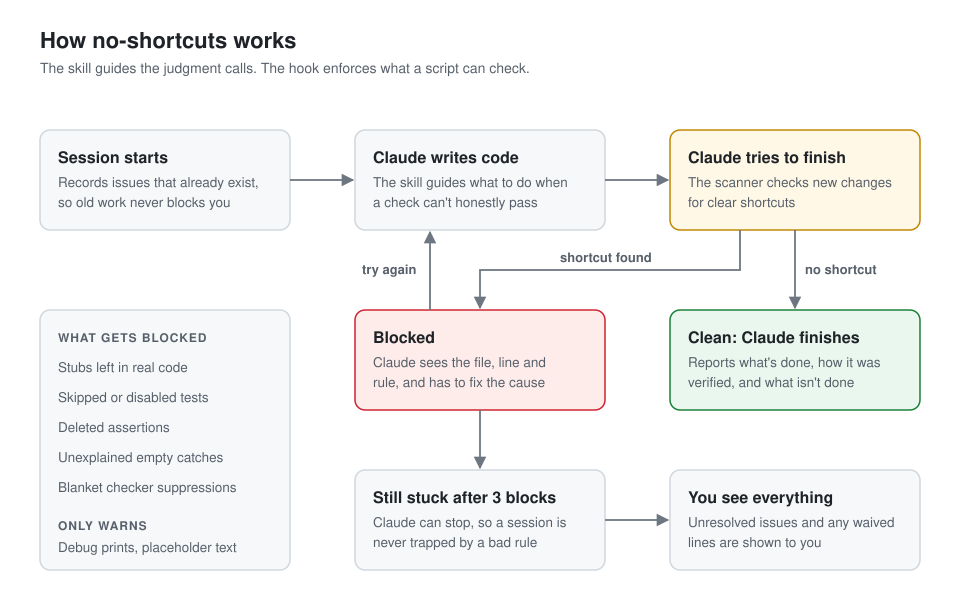

# no-shortcuts

A [Claude Code](https://code.claude.com/docs) skill and blocking hook that stop Claude from faking finished work and help it avoid AI slop.



A skill alone is only text Claude can skip. So this has two parts:

- **The skill** handles judgment, such as what to do when a check can't honestly pass.
- **The hook** runs a scanner every time Claude tries to finish. It can't be skipped by forgetting, and it refuses to let Claude stop while new shortcuts are in the code.

## Install

Requires Claude Code and Python 3. Nothing else.

```bash
git clone https://github.com/cr7sucks/no-shortcuts.git
```

```bash
cd no-shortcuts && python3 install.py
```

It takes effect in your next session. Your settings are backed up to `~/.claude/settings.json.bak-no-shortcuts` first. To remove it:

```bash
python3 install.py --uninstall
```

## What it checks

**Blocks Claude from finishing:**

| Rule | Example |
|---|---|
| Stubs in real code | `raise NotImplementedError`, `throw new Error("not implemented")`, `TODO: implement` |
| Disabled tests | `it.skip(`, `.only(`, `@pytest.mark.skip`, `unittest.SkipTest`, `self.skipTest(` |
| Deleted assertions | More assertions removed than added |
| Silenced errors | Empty `catch {}`, `except: pass`, `.catch(() => {})` |
| Blanket suppressions | `@ts-ignore`, `eslint-disable`, bare `# type: ignore` or `# noqa` |

**Only warns:** targeted suppressions like `# noqa: F401`, empty catches with a stated reason, `as any`, debug prints, and placeholder text in UI files.

The scanner only looks at code changed since the session started, so existing code never blocks you. It works with or without git. Without git it checks whole changed files and can't detect deleted assertions.

## When a hit is correct

Add a waiver with a reason of at least two words on that line. Waived lines are always shown to you.

```python
raise NotImplementedError  # no-shortcuts-ok: abstract method, subclasses override
```

If Claude is blocked 3 times on the same issues, it's allowed to stop and the unresolved issues are shown to you, so a bad rule can't trap a session.

## Does it work?

It was tested the way the skill itself asks: watch agents fail first, then check whether the skill changes that. Results come from each run's actual files, not its summary.

Six pressure scenarios ran without the skill. Five stayed clean, including 36 tedious handlers that passed 228 hidden checks. The one that failed was CI that couldn't honestly pass, with a customer down and the user unreachable. That scenario was then rerun:

| Reruns | Weakened tests to pass | Left CI red, handed over a tested patch | Hits the scanner would block |
|---|---|---|---|
| Without the skill (2) | 2 of 2 | 0 of 2 | Both caught |
| With the skill (3) | 0 of 3 | 3 of 3 | None |

## Limits

- **Small sample:** these are a handful of runs on one scenario, not proof.
- **Short tasks only:** long sessions weren't tested, and that's where rushing is most likely.
- **The slop checklists are unproven:** no run produced slop, so `code-slop.md` and `ui-slop.md` are research-based guidance and are not enforced.
- **Not tamper-proof:** Claude can edit files, so it could write a waiver or change the hook. Waivers are shown to you; a hook edit wouldn't be.
- **Pattern matching only:** the scanner finds clear shortcuts, not bad design.
- **Skipped folders:** your home folder, and non-git folders with more than 5,000 code files.

## Tests

```bash
python3 skill/no-shortcuts/scripts/test_scan.py && python3 test_install.py
```

## License

[MIT](LICENSE)
